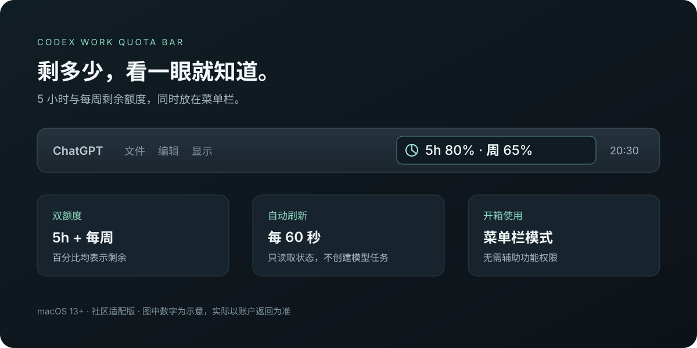

# Codex Work Quota Bar

在 macOS 菜单栏同时查看 Codex 的 **5 小时剩余额度**与**每周剩余额度**。

**v1.1.1 低额度保护：**可在菜单中启用 Codex Hook 接入，5 小时剩余不高于默认 15% 时，在下一次工具调用完成后提示保存进度并结束本轮。阈值可调。同一本机工具共享的 5 小时周期，所有会话合计只提醒一次；提醒后你可以发出继续指令。首次需要在 `/hooks` 中审查并信任；仅支持加载该 Hook 的本机 Codex。详见 [接入说明](docs/QUOTA_GUARD.md)。

适配使用 `com.openai.codex` 标识的 ChatGPT / Codex 应用，兼容旧版 `Codex.app`。独立运行，不修改主应用的安装文件。



> 图片为效果示意，不是任何用户的账号数据。实际窗口与数值以已登录账户返回的结果为准。

本项目基于 [Thinkdiff-lw/codex-quota-bar v1.0.0](https://github.com/Thinkdiff-lw/codex-quota-bar/tree/v1.0.0) 修改，保留 MIT 许可证。它是社区适配版本，与 OpenAI 无隶属关系，也不是原作者发布的原版安装包。

## 功能

- 菜单栏同时显示 `5h 80% · 周 65%`，百分比表示**剩余**。
- 点击菜单查看两个窗口的重置倒计时；悬停提示包含重置日期和最近读取时间。
- 约每 **60 秒**读取一次额度；倒计时在本地更新。
- 默认使用菜单栏模式，**不需要辅助功能或屏幕录制权限**。
- 可选悬浮条跟随窗口、手动校准位置、登录启动。
- 读取失败时保留上次数据并标记待更新；没有返回的窗口不会凭空显示为满额。
- “暂停自动刷新”停止后续定时查询并隐藏悬浮条，菜单栏明确标记“已暂停”；暂停时仍可“立即刷新一次”。
- 主应用退出后标记旧数据待更新，重新打开后自动重新连接；退出额度条后关闭其 CLI 子进程。
- 可选低额度保护，预设 5% / 10% / 15% / 20% / 25% / 30%，也可自定义 1–90%；按实际 5 小时周期持久去重，所有会话合计只提醒一次。

## 快速开始

需要 macOS 13+，以及已登录 ChatGPT 账户的 Codex CLI。Plus 账户已验证能返回 5 小时和周额度；其他账户实际显示取决于服务端返回。

1. 从**本仓库的 Releases** 下载 `CodexWorkQuotaBar-macOS.zip` 并解压。若还没有发布包，可按下方步骤自行构建。
2. 将 `CodexQuotaBar.app` 移入“应用程序”，双击打开。
3. 打开已登录的 ChatGPT / Codex 应用，等待几秒，查看**屏幕顶部的菜单栏**。

**应用没有普通主窗口，也不显示 Dock 图标。双击后没有弹出窗口是正常现象。** 菜单栏会出现圆环图标，成功读取后显示两个剩余百分比。

首次打开可能遇到“无法验证开发者”提示：本项目使用 ad-hoc 本地签名，尚无 Apple Developer ID 签名或公证。请先核对来源，再依照 [Apple 的说明](https://support.apple.com/zh-cn/102445)决定是否允许打开。无需关闭全系统安全保护。

更多步骤见 [macOS 使用说明](docs/macos.md)。

## 会额外消耗 Codex 额度吗？

额度查询启动本机 `codex app-server`，仅发送：

```text
initialize
initialized
account/rateLimits/read
```

它不发送提示词、不创建模型任务，也不使用额度重置奖励。根据当前源码的调用方式，**查询本身不应消耗 5 小时或每周的模型使用额度**。正常执行 Codex 任务仍会使用额度。

启用低额度保护后，Hook 仅在本地检查状态，达到阈值才向当前任务返回一次收尾提示；模型理解提示并保存进度会继续使用额度。不要把低额度保护的收尾开销与只读查询混为一谈。

连续运行 24 小时约查询 1440 次，会产生少量网络和系统资源开销。主应用存在但位于后台时，工具仍会查询；如果不需要，可从菜单中暂停或退出。

接口依据：[官方 Codex App Server 文档](https://learn.chatgpt.com/docs/app-server#6-rate-limits-chatgpt)。本项目只展示接口结果，不承诺固定的额度窗口、查询服务可用性或未来接口行为。

## 权限与隐私

| 功能 | 权限 / 数据使用 |
| --- | --- |
| 菜单栏额度 | 不需要辅助功能权限；使用 CLI 既有登录态 |
| 跟随主应用窗口 | 需要辅助功能权限，默认关闭 |
| 屏幕录制 | 不需要 |
| 登录启动 | 由用户在菜单中主动开启 |
| Codex 低额度保护 | 主动开启后合并用户 Hook 配置，需在 Codex 中审查并信任；默认不启用 |
| 独立遥测或第三方上传 | 当前工具源码未实现；官方 CLI 的行为由其自身配置决定 |

工具不直接读取或保存登录令牌、密码、Cookie 或聊天正文，不保存 CLI 标准输出和错误输出。启用保护后，在用户 Application Support 目录保存额度状态和去重回执（会话 ID 摘要，不含聊天内容）。辅助功能定位只请求控件角色、位置、大小及按钮名称，不请求输入框正文。

**辅助功能本身是范围较广的系统权限**，不被上述代码用途严格限制；应用也未启用 App Sandbox。请只运行你信任的构建。SHA256 校验用于核对文件一致性，不能代替安全审计。

详细说明见 [安全与隐私](docs/SECURITY.md)。

## 从源码构建

需要 Xcode Command Line Tools；测试还需要可在终端运行的 Python 3。发布的 `.app` 不依赖 Python 或 Node.js。

在项目根目录运行：

```bash
bash macos/test.sh
bash macos/build.sh
```

构建输出：

```text
macos/dist/CodexQuotaBar.app
macos/dist/CodexWorkQuotaBar-macOS.zip
macos/dist/CodexWorkQuotaBar-macOS.zip.sha256
```

构建脚本生成 arm64 / x86_64 通用应用，并执行 ad-hoc 签名验证。Intel 架构可编译不代表主应用支持所有 Intel Mac。

测试覆盖额度换算、双窗口、倒计时、相对位置、模拟 stdio、刷新与重启状态，以及低额度阈值、快照失效、并发与持久去重、原有 Hook 配置保护、备份和移除。当前共 97 项检查，使用临时目录与模拟事件，不向真实任务发提示。菜单栏基础显示已在 macOS 15.6 / Apple Silicon 确认；v1.1.0 已由用户验证 CLI 能接收提示并保存进度；v1.1.1 的周期去重与继续语义已通过本地模拟检查，实际任务行为仍需确认。Hook 接入需要用户审查信任。悬浮定位、多屏与登录启动仍需更多实机验证。

## 相比上游 v1.0.0 的变化

| 项目 | 本适配版 |
| --- | --- |
| 主应用识别 | 加入 `com.openai.codex`，保留旧 `Codex.app` 识别 |
| CLI 路径 | 覆盖应用内 `codex-cli/CodexCLI.app/Contents/MacOS/codex` |
| 菜单栏显示 | 同时显示 5 小时、周剩余百分比 |
| 悬浮条 | 有空间时同时展示两个窗口的剩余百分比 |
| 辅助功能 | 菜单栏模式无需授权，跟随窗口默认关闭 |
| 暂停 | 停止后续自动刷新并隐藏悬浮条 |
| 项目范围 | 当前仅维护 macOS 适配，不包含 Windows 版本 |

## 分享与发布

- 想上传自己的仓库：见 [GitHub 上传指南](docs/GITHUB_UPLOAD.md)。
- GitHub Actions 会运行测试和构建；推送 `v*` 标签时创建包含安装包的 **Release 草稿**，供维护者检查后发布。
- 请保留 [LICENSE](LICENSE) 与 [NOTICE](NOTICE)。
- 不要上传 `.codex`、`auth.json`、Cookie、个人日志或账户截图。

## 致谢与许可

原项目：[Thinkdiff-lw/codex-quota-bar](https://github.com/Thinkdiff-lw/codex-quota-bar)。

基于标签 `v1.0.0`，提交 `141b6ce6c45cf2acd44d8326414d2946e84a68ff`。本项目保留上游版权声明；变更记录见 [CHANGELOG.md](CHANGELOG.md)。

MIT License，详见 [LICENSE](LICENSE)。
